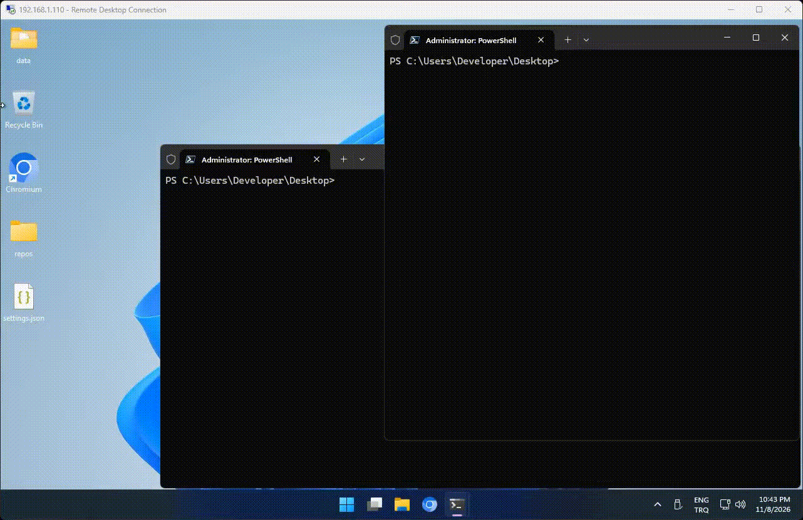

# microgit
Lightweight self-hosted git server

## Install
```bash
npm install -g microgit-server
```

## Run the server

```bash
microgit-server                  # uses settings.json in the current directory
microgit-server --settings       # open the interactive settings editor
microgit-server -s               # shorthand for --settings
microgit-server settings         # same as --settings
```

The `--settings` flag opens a terminal menu to edit `settings.json`: pick a
setting by number, enter a new value, or press `h` for a help screen describing
every option. Press `0` to save and exit, `q` to discard.

## CLI (companion package)

The `microgit-cli` package is a first-class part of this project: it is the
recommended way to drive the server day to day. It keeps your session, creates
and deletes repositories, and wraps `git` so push and pull use your account
credentials automatically. Published separately so it can be installed on any
machine that talks to the server:

## Install
```bash
# 1. Register an account (non-interactive example).
microgit register --url http://127.0.0.1:80 --user abc --password 1234
# 2. Sign in (non-interactive example).
microgit login --url http://127.0.0.1:80 --user abc --password 1234
# 3. Create a repository and a local checkout with a first commit,
#    then push it.
microgit new app --init
# 4. Work as usual; commit also pushes.
cd app
echo "hello" > hello.txt
microgit commit -m "Add hello.txt"
# 5. The repository is now live at:
#    http://127.0.0.1:80/abc/app.git
#    (visit it, or clone it from anywhere with `microgit clone` / `git clone`).
# 6. Check the session or list repositories.
microgit whoami
microgit list
```


## Repository page

`http://<host>/<user>/<repository>/` opens the web view of a repository (the
trailing slash is canonical; without it the server redirects). Nothing extra is
stored for it: the page reads the bare repository with plain `git` commands.

- Title, privacy badge, commit count and the repository size on disk, with the
  repository identified as `user@repo.git`.
- The clone URL behind the **Git URL** button, ready to copy.
- The newest commit plus one row per entry, each with the last commit that
  touched it. Every directory and file is a real link:
  `/<user>/<repo>/tree/<dir>/` lists a directory and
  `/<user>/<repo>/blob/<file>` shows the file, with `?raw=1` for plain text.
- `README.md` (or `README.markdown`) of the directory being viewed, rendered as
  markdown; `?raw=1` shows the same file as plain text, so neither view can
  inject HTML into the page.
- An empty repository still renders, with the `git clone` hint.

All of it is read from git on the request: nothing is cached in a template or
sent as static HTML.

Git URLs keep working next to the page: `git clone` uses the protocol paths below
`/alice/app.git` (`info/refs`, `git-upload-pack`, …), which `git http-backend`
still handles. Opening the bare clone URL in a browser redirects to the page, so
`/alice/app.git` lands on `/alice/app/` instead of a blank response. A private
repository's page answers `404` unless the caller is the owner, an administrator
or a member with `read` access who is signed in with a session cookie. Markdown is rendered by a small built-in renderer
(headings, paragraphs, lists, quotes, code, links, bold, italics, images, tables,
task lists, strikethrough, callouts) — no dependency was added for it.

## Administrators

Admin rights live in one place only: `users.is_admin` in `data/users.db`. There is
no settings key that can grant them, so editing `settings.json` never promotes an
account. The first account created on a fresh server is an administrator.

- Only the owner of an admin account may list accounts or change the flag (`403`
  otherwise); the change is audited as `user.admin` and applies to the next
  request, because cached sessions are cleared.
- The **last** administrator cannot be demoted (`409`); otherwise nobody could
  delete repositories or read the audit trail.
- If the database ends up with no administrator at all (restored or imported
  `users.db`), the oldest account is promoted at startup and the log says so.

## Repository access

A repository belongs to its owner. The owner (and any administrator) can hand
access out to other accounts without sharing the account itself, through the
`repo_members` table in `data/repo.db`:

- `read` — open the repository page, clone and fetch
- `write` — everything `read` does, plus push

The roles are cumulative: granting `write` never takes read away.

The owner and administrators are never stored as members, because they already
hold every right. Granting the same account twice is not an error: the role is
updated and the answer is `200` instead of `201`. Revoking removes the row.
Deleting a repository removes its members with it (`ON DELETE CASCADE`).

A private repository answers `404` to callers it would not show itself to — on
the page, on the API and on the git protocol — so membership cannot be used to
probe which private repositories exist. Memberships are audited as
`repo.member.add`, `repo.member.update` and `repo.member.remove`.

## API reference

| Method | Path | Auth | Purpose |
| --- | --- | --- | --- |
| POST | `/api/register` | — | Create an account, returns a session token |
| POST | `/api/login` | — | Exchange username/password for a token |
| POST | `/api/logout` | Session | Revoke the session and clear the cookie |
| GET | `/api/me` | Session | Current account and MOTD |
| POST | `/api/new` | Session | Create a repository |
| POST | `/api/delete` | Session | Delete a repository |
| DELETE | `/api/repos/<owner>/<name>` | Session | Delete a repository (REST) |
| GET | `/api/repos` | — | List repositories |
| GET | `/api/repos/<owner>/<name>` | — | One repository |
| GET | `/api/repos/<owner>/<name>/members` | — | Who else may open the repository |
| POST | `/api/repos/<owner>/<name>/members` | Session (owner) | Grant access: `{"username":"bob","role":"read"}` |
| DELETE | `/api/repos/<owner>/<name>/members/<username>` | Session (owner) | Revoke access |
| GET | `/api/settings` | — | Public settings |
| GET | `/api/users` | Session (admin) | Every account and its admin flag |
| PATCH | `/api/users/<username>` | Session (admin) | Grant or revoke the admin flag |
| GET | `/api/audit?format=json\|html` | Session (admin) | Audit trail |
| GET | `/` | — | HTML landing page (brand, MOTD, clone URL) |
| GET | `/<owner>/<name>/` | — | Repository page (`?raw=1` for plain README) |
| GET | `/health` | — | Liveness and counts |
| GET | `/metrics` | — | Counts, cache and memory numbers |

"Session" means the `sid` cookie set by login, or an `Authorization: Bearer <token>`
header for scripts. Git pushes use HTTP Basic with the account password instead.

A member's `role` decides what the account may do with the repository: `read`
opens the pages and allows cloning and fetching, `write` adds pushing. The owner
and administrators are never stored as members — they already hold every right.
Granting the same account twice is not an error: the role is updated and the
answer is `200` instead of `201`. A private repository answers `404` to callers
it would not show itself to, so membership cannot be used to find private
repositories.

Errors are JSON: `{"error":"..."}`. `400` invalid input, `401` no/expired
session, `403` wrong account, `404` unknown repository, `409` name conflict,
`413` body too large.

### Audit trail

Every create, delete, registration, login, logout, push and refused read is
recorded in `users.db` with time, actor, repository, status code, IP and detail.
Administrators can read it. Passwords and tokens are never written to the audit
trail, and only their hashes are stored in the database.

## settings.json

Created on first start; edit it on the server, there is no HTTP endpoint for it.
Run `microgit-server --settings` (or `-s`) for an interactive terminal editor,
or edit the file directly.

| Key | Default | Meaning |
| --- | --- | --- |
| `host` | `"127.0.0.1"` | Bind address (loopback keeps it private) |
| `brand` | `"Microgit"` | Name in the page header, the HTML title and the footer |
| `tagline` | `""` | Word after the brand in the header; empty shows only the brand |
| `port` | `3000` | TCP port to listen on |
| `reposDir` | `"repos"` | Where bare repositories are stored |
| `dataDir` | `"data"` | Where the SQLite files are stored |
| `publicUrl` | `""` | Full origin used in clone URLs and generated links; empty = derive from the request |
| `domain` | `""` | Public domain shown in the UI instead of the IP; `git.example.com` or `https://git.example.com` |
| `trustProxy` | `false` | Read `X-Forwarded-Proto/Host/For` from a reverse proxy |
| `motd` | `""` | Banner shown after signing in; empty = none |
| `allowRegistration` | `true` | Allow `POST /api/register` |
| `template` | `""` | Folder copied into every new repository |
| `sessionDays` | `7` | API session lifetime |
| `maxPushBytes` | `0` | Maximum size of one pushed pack (`0` = unlimited) |
| `cacheTtlMs` | `5000` | In-memory lookup cache TTL |

`host`, `port`, `reposDir`, `dataDir`, `publicUrl` and `domain` are read **once
at startup**, so restart after changing them (the data directories especially
cannot move while their databases are open). `motd`, `template`, `brand`,
`tagline`, `allowRegistration`, `sessionDays`, `maxPushBytes` and `cacheTtlMs`
are read per request and apply immediately.

### Using a domain instead of the IP

Set `domain` when the server is reached through a hostname, so the clone buttons,
copy field, links and API responses show the domain instead of whatever address
the request arrived on:

```json
{
  "domain": "git.example.com"
}
```

A bare host is assumed to be HTTP; write the scheme explicitly when the server is
behind TLS:

```json
{
  "domain": "https://git.example.com"
}
```

Precedence for the public origin is `PUBLIC_URL` (environment) → `publicUrl` →
`domain` → the request's `Host` header. That means you only need one of
`publicUrl` or `domain`; if `publicUrl` is already set, it wins. Restart the
server after changing either one.

## Install


## manuel repo push curl+git (commit,push,pull) 
Please Read to `manuel-git-usage.md`